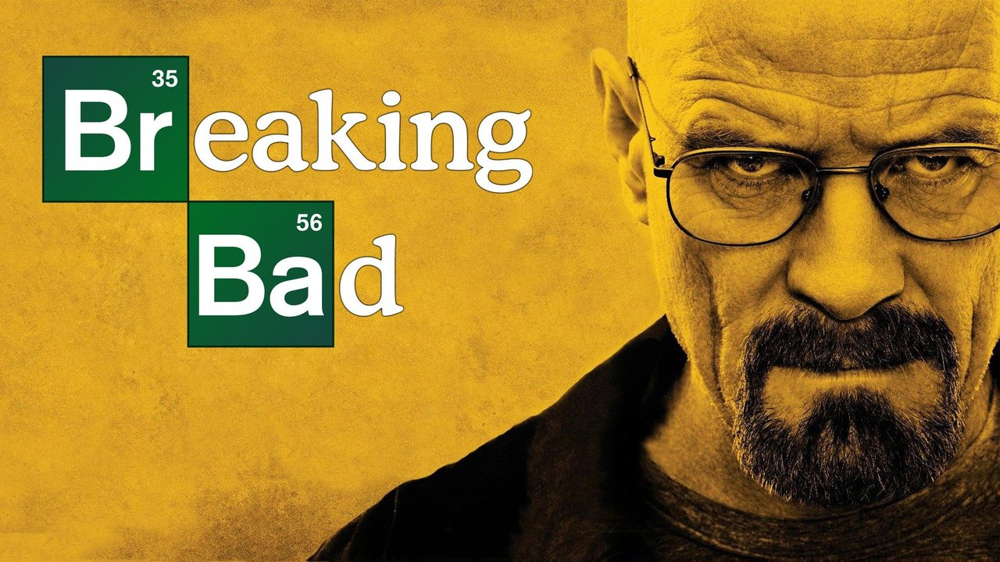

<div align="center">

# 🎬 Netflix India Clone

### A pixel-perfect Netflix India clone built with pure HTML, CSS & JavaScript

[](https://rahulsinghkushwaha232.github.io/Netflix-Clone/)
[](https://github.com/rahulsinghkushwaha232/Netflix-Clone/stargazers)
[](LICENSE)



**Built with ❤️ by [Rahul Singh Kushwaha](https://github.com/rahulsinghkushwaha232)**

[Features](#-features) • [Tech Stack](#-tech-stack) • [Pages](#-pages) • [Getting Started](#-getting-started) • [Screenshots](#-screenshots) • [Contributing](#-contributing)

---

</div>

## ✨ Features

| Feature | Description |
|---------|-------------|
| 🎥 **Netflix Intro Animation** | Cinematic intro video on page load with skip functionality |
| 🖼️ **Banner Slideshow** | Auto-sliding hero banner with dot navigation & arrow controls |
| 🌙 **Dark / Light Theme** | Toggle between dark and light mode with persistent storage |
| 📱 **Fully Responsive** | Works perfectly on Desktop, Tablet & Mobile devices |
| 🍔 **Hamburger Menu** | Animated mobile navigation with focus trapping |
| 🔍 **Search Bar** | Expandable search with Netflix-styled animations |
| 📜 **Horizontal Scroll Rows** | Netflix-style content carousels with scroll buttons |
| ⏯️ **Continue Watching** | Progress bars showing watch progress |
| 🔝 **Scroll to Top** | Floating back-to-top button with smooth scrolling |
| ♿ **Accessibility** | ARIA labels, keyboard navigation & semantic HTML |
| 🎭 **Hover Effects** | Poster zoom, overlay & quick-play on hover |
| 👆 **Touch Swipe Support** | Swipe banner slides on mobile devices |

## 🛠️ Tech Stack

<div align="center">


</div>

- **HTML5** — Semantic markup with accessibility features
- **CSS3** — Flexbox, Grid, CSS Variables, Animations, Media Queries
- **JavaScript (Vanilla)** — DOM manipulation, Event handling, Local Storage
- **Google Fonts** — Poppins font family

## 📄 Pages

| # | Page | File | Description |
|---|------|------|-------------|
| 1 | 🏠 **Home** | `index.html` | Hero banner, Netflix Originals, Trending, Continue Watching |
| 2 | 📺 **TV Shows** | `tv-shows.html` | TV series collection with genre categories |
| 3 | 🎬 **Movies** | `movies.html` | Movies library with poster grid |
| 4 | 🔥 **New & Popular** | `newpopular.html` | Latest releases and trending content |
| 5 | 📋 **My List** | `my-list.html` | Saved favorites with manage profiles |
| 6 | 📝 **Sign Up** | `signup.html` | User registration form |

## 🚀 Getting Started

### Prerequisites
- A modern web browser (Chrome, Firefox, Edge, Safari)
- Git installed on your system

### Installation

```bash
# Clone the repository
git clone https://github.com/rahulsinghkushwaha232/Netflix-Clone.git

# Navigate to project directory
cd Netflix-Clone

# Open in browser
start index.html          # Windows
open index.html           # macOS
xdg-open index.html       # Linux
```

### Using Live Server (Recommended)
1. Install **Live Server** extension in VS Code
2. Right-click on `index.html` → **Open with Live Server**
3. The project opens at `http://127.0.0.1:5500`

## 📸 Screenshots

<div align="center">

### 🏠 Home Page — Hero Banner
> Cinematic banner slideshow with Breaking Bad featured content

### 📺 Netflix Originals Section
> Horizontal scrollable poster rows with hover effects

### 🌙 Dark / Light Theme
> Seamless theme toggle with persistent user preference

### 📱 Mobile Responsive
> Fully optimized for mobile devices with hamburger menu

</div>

## 📁 Project Structure

```
Netflix-Clone/
├── 📄 index.html          # Home page
├── 📄 tv-shows.html       # TV Shows page
├── 📄 movies.html         # Movies page
├── 📄 newpopular.html     # New & Popular page
├── 📄 my-list.html        # My List page
├── 📄 signup.html         # Sign Up page
├── 🎨 style.css           # Complete stylesheet
├── ⚡ app.js              # JavaScript functionality
├── 🖼️ images/             # Movie posters & assets
│   ├── bb2.jpg            # Breaking Bad
│   ├── st2.jpg            # Stranger Things
│   ├── mh.webp            # Money Heist
│   ├── friends.jpg        # Friends
│   ├── hoc.jpg            # House of Cards
│   ├── dn.webp            # Death Note
│   └── ... (30+ images)
├── 🎥 videos/
│   └── netflix_intro.mp4  # Netflix intro animation
└── 📖 README.md           # Documentation
```

## 🎯 Key Highlights

- ✅ **No Frameworks** — Pure HTML, CSS & JavaScript
- ✅ **No Dependencies** — Zero external libraries
- ✅ **SEO Optimized** — Meta tags, semantic HTML, descriptive alt texts
- ✅ **Cross-Browser Compatible** — Works on all modern browsers
- ✅ **Performance Optimized** — Lazy loading images, efficient CSS
- ✅ **Clean Code** — Well-commented, organized & maintainable

## 🤝 Contributing

Contributions are welcome! Feel free to:

1. ⭐ Star this repository
2. 🍴 Fork the project
3. 🔧 Create a feature branch (`git checkout -b feature/amazing-feature`)
4. 💾 Commit your changes (`git commit -m 'Add amazing feature'`)
5. 📤 Push to the branch (`git push origin feature/amazing-feature`)
6. 🔃 Open a Pull Request

## 📝 License

This project is for **educational purposes only**. All Netflix branding, logos, and content belong to Netflix, Inc. This is a clone project made for learning web development.

## 🙏 Acknowledgements

- [Netflix](https://www.netflix.com) — For the design inspiration
- [Google Fonts](https://fonts.google.com) — For the Poppins font
- [TMDB](https://www.themoviedb.org) — For movie poster references

---

<div align="center">

### ⭐ If you liked this project, don't forget to give it a star!

**Made with ❤️ by [Rahul Singh Kushwaha](https://github.com/rahulsinghkushwaha232)**

[](https://github.com/rahulsinghkushwaha232)

</div>